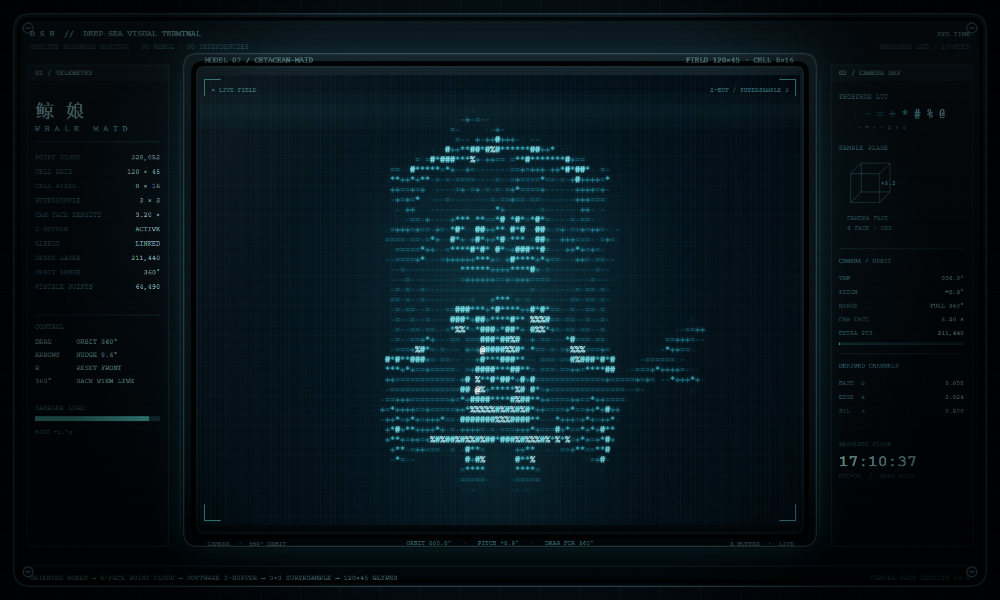
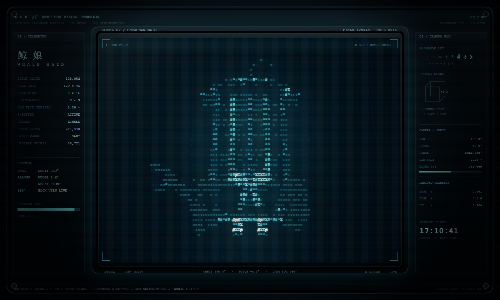

# DEEP SEA TERMINAL — 鲸鱼女仆 ASCII 点云终端

一个**单文件、零依赖、完全离线**的交互式 3D ASCII / CRT 艺术页：鲸鱼女仆的模型先被拆成带朝向的盒子，再采样成六面点云，最后用纯 JavaScript 软件渲染成 `120 × 45` 个字符，套上扫描线、荫罩和暗角，像一台沉在深海里的老终端。

在线预览：<https://charaaah.github.io/whalechang/>





---

## 它是什么

- **不是** three.js / WebGL / Canvas 3D，也没有任何 CDN、npm 包或外部字体。
- 全部逻辑都在一个 `index.html` 里：结构、样式、几何、投影、光栅化、字符合成、CRT 后期。
- 画面固定 `1600 × 960`，按视口等比缩放；内部始终按固定分辨率渲染，不会因窗口尺寸改变构图。
- 没有 `Math.random()`：几何、采样、光照、抖动全部确定，同一时刻渲染结果可复现。

## 操作方式

| 操作 | 效果 |
| --- | --- |
| 左右拖动 | 绕角色做完整 **360°** 环绕（方向与鼠标移动相反） |
| 上下拖动 | 俯仰视角，限制在约 ±11° 内 |
| `←` / `→` | 每次微调约 8.6°（0.15 rad） |
| `R` | 复位到正面、水平视角 |
| 打开 `?yaw=180` | 直接从背面开始，方便对比正/背面 |

触屏同样支持拖动。

## 渲染管线

```
带朝向的盒子 (OBB)
   └─ 六面采样 → 点云（每点记录 albedo 与法线）
        └─ 面向相机的面额外加密（约 3.2×）
             └─ 软件相机 + 透视投影 + Z-Buffer
                  └─ 3×3 超采样 → 120×45 字符单元（8×16 px）
                       └─ Sobel 轮廓 + 覆盖率剪影
                            └─ v = base*0.68 + edge*0.50 + sil*0.34
                                 └─ LUT  .:-=+*#%@
                                      └─ CRT 扫描线 / 荫罩 / 暗角
```

### 关键实现

- **点云是有颜色的**：每个采样点计算
  `albedo = 0.299r + 0.587g + 0.114b`，再叠加主光、背光与背补光，不会退化成灰模。
- **动态密度**：全模型保留基础层，只有当前正对相机的面才追加一层采样点；背对相机的额外点直接跳过。这样既保证轮廓处的信息量，又避免无意义的点数膨胀。当前场景约 **32.8 万点**。
- **软投影 + Z-Buffer**：自己维护相机 `right/up/forward` 基向量，逐点做透视除法与深度测试，没有依赖任何图形 API。
- **字符选择有依据**：每个 8×16 单元做 3×3 超采样得到覆盖率与亮度；Sobel 只负责勾边，并且用局部亮度做门限，所以瞳孔、发丝这类暗部细节不会被边缘吃掉。
- **背面不是空白**：背面单独补了腰后蝴蝶结、后摆褶边、发丝高光，并加了一盏背补光；转到 180° 仍然有层次。
- **CRT 质感**：横向扫描线、RGB 荫罩条纹、屏幕暗角、轻微刷新闪动，全部用 Canvas 2D 逐帧绘制。

## 运行

直接双击 `index.html` 即可，无需构建：

```bash
# 可选：起一个本地静态服务器
python -m http.server 8000
# 然后打开 http://localhost:8000/
```

推荐桌面版 Chrome / Edge / Safari。CPU 软件渲染对单核性能敏感，低端设备或移动端可能掉帧。

## 目录结构

```
.
├── index.html      # 全部内容：几何、渲染、HUD、交互
├── front.png       # 正面截图
├── back.png        # 180° 背面截图
└── README.md
```

## 已知限制

- 角色是**盒子拼出来的**，不是雕刻模型；正侧面 90° 时脸和鼻子仍然偏薄、偏暗，这是当前几何的固有短板。
- 32 万点全部由 CPU 逐帧处理，帧率取决于单核性能；这不是一个可以无限加细节的架构。
- 画面比例固定为 1600×960，超宽屏上会留黑边。
- 角色造型、配色与 HUD 文案都是为这一只鲸鱼女仆定制的，换成别的角色需要重做几何与采样配置。

## 开发备注

所有可调参数都集中在 `index.html` 顶部的常量区：

- `GRID_W / GRID_H / CELL_W / CELL_H`：字符网格与单元尺寸
- `BASE_DENSITY / CAMERA_FACE_BOOST`：基础采样密度与朝向加密倍率
- `CAM_RADIUS / FOCAL / CAM_TARGET`：相机距离、焦距与注视点
- `LUT`：字符亮度阶梯
- 合成权重 `0.68 / 0.50 / 0.34`：基础亮度、边缘、剪影的配比

改完直接用浏览器刷新即可，没有编译步骤。
